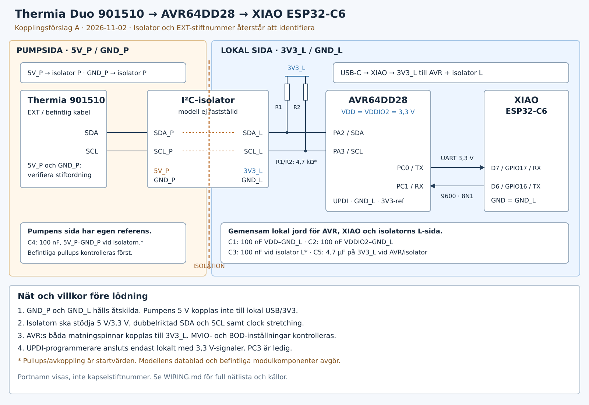

# Thermia Duo 901510 – XIAO ESP32-C6 och AVR64DD28

**Preliminärt schema, revision A, 2026-11-02.**

Förslaget ersätter den tidigare RS485-kopplingen med direkt UART på samma
labbkort. ThermiaWire kör fortfarande som I²C-slav, pumpen är master.

## Matning och domäner

- Lokal sida: USB-C till XIAO från separat matning. XIAO:s 3V3 förs till AVR VDD,
  AVR VDDIO2 och isolatorns lokala matning, under förutsättning att isolatorn
  stöder 3,3 V. Kontrollera regulatorns strömbudget när isolatorn identifierats.
- Båda AVR-matningspinnarna kopplas fysiskt till 3,3 V, även om MVIO redan är
  aktiverat. Ingen säkringsändring utförs av projektets vanliga byggning.
  Innan ombyggnad kontrolleras även att BOD-nivån är lämplig för 3,3 V.
- Pumpsida: isolatorns pumpsida får sin matning och jordreferens från den
  verifierade pumpkopplingen. `5V_P` är en logisk nätbeteckning, inte en uppgift
  om ett visst stiftnummer eller tillgänglig effekt på EXT-kontakten.
- **GND_P och GND_L förbinds inte.** Inte heller pumpens 5 V och USB:s 5 V
  förbinds. USB/programmerare ansluts endast på den lokala sidan. Isolatorn
  överför signaler, inte matning; gemensam icke-isolerad matning skulle gå runt
  signalernas galvaniska avskiljning.

## Nätlista

| Nät | Anslutningar |
| --- | --- |
| `3V3_L` | XIAO 3V3, AVR VDD, AVR VDDIO2, isolatorns lokala VDD, R1/R2 övre anslutningar |
| `GND_L` | XIAO GND, alla AVR GND, isolatorns lokala GND, lokala avkopplingskondensatorer |
| `SDA_L` | AVR PA2, isolatorns lokala SDA, R1 nedre anslutning |
| `SCL_L` | AVR PA3, isolatorns lokala SCL, R2 nedre anslutning |
| `UART_AVR_TX` | AVR PC0/TX → XIAO D7/GPIO17/RX |
| `UART_XIAO_TX` | XIAO D6/GPIO16/TX → AVR PC1/RX |
| `UPDI` | AVR UPDI, separat programmeringskontakt med lokal jord och 3,3 V-referens |
| `5V_P`, `GND_P`, `SDA_P`, `SCL_P` | Endast pumpen och isolatorns pumpsida; fysisk EXT-stiftordning återstår |

PC3 används inte. Modbus RTU körs med adress 42, 9600 baud, 8N1.

## Passiva komponenter och isolator

- C1: 100 nF mellan AVR VDD och GND_L, nära matningspinnen.
- C2: 100 nF mellan AVR VDDIO2 och GND_L, nära matningspinnen.
- C3: 100 nF mellan isolatorns lokala VDD och GND_L, med modellens krav som grund.
- C4: 100 nF mellan isolatorns pump-VDD och GND_P, med modellens krav som grund.
- C5: 4,7 µF mellan 3V3_L och GND_L vid AVR/isolator, som lokal bulkavkoppling.
- R1/R2: 4,7 kΩ till 3V3_L är **startvärden** för en kort lokal I²C-buss, inte
  slutligt dimensionerade värden. Modulens befintliga pullups räknas in; dubblera
  dem inte utan att kontrollera effektiv resistans. Kontrollera bussens kapacitans,
  uppmätt klockfrekvens, stigtid och isolatorns sink-/tröskelkrav.
- Pumpsidans pullups antas finnas i den befintliga fungerande kopplingen och
  behöver identifieras; inga extra pumpsidepullups föreskrivs här.
- Isolatorn måste stödja olika matningar, 3,3 V lokalt/5 V på pumpsidan, samt
  dubbelriktad SDA **och SCL**. AVR:s TWI-slav kan stretcha klockan. ISO1540 är ett
  exempel på en krets med sådana funktioner; detta är ingen identifiering av den
  befintliga modulen och inte ett krav att köpa en ny.

Schemat visar isolatorn som en funktionsenhet. Sidornas logiska namn anger deras
användning, inte tillverkarens sida 1/sida 2. Verkligt pinout, orientering,
spänningsfall på låg nivå och pullupvärden fastställs mot den identifierade kretsen.
Ett vanligt I²C-nivåskiftarkort är inte en galvanisk isolator.

## Kvar innan lödning

En bild eller kretsmärkning på den befintliga isolatorn räcker för nästa steg.
Bekräfta också AVR-kortets verkliga kapsling/adapter och den fungerande
EXT-kopplingens stift. Därefter kan schemat få fysiska stiftnummer och slutliga
komponentvärden. Layout på labbkortet behöver hålla pump- och lokaljord åtskilda;
schemat i sig fastställer inte en viss säkerhets-/isolationsklass för bygget.

## Primärkällor

- [Seeed XIAO ESP32-C6: D6=GPIO16 TX, D7=GPIO17 RX](https://wiki.seeedstudio.com/xiao_esp32c6_getting_started/)
- [Microchip AVR64DD32/28 datablad: matning, MVIO och portmultiplexering](https://ww1.microchip.com/downloads/en/DeviceDoc/AVR64DD32-28-Prelim-DataSheet-DS40002315B.pdf)
- [TI ISO1540: separata matningar och dubbelriktad SCL/clock stretching](https://www.ti.com/product/ISO1540)
